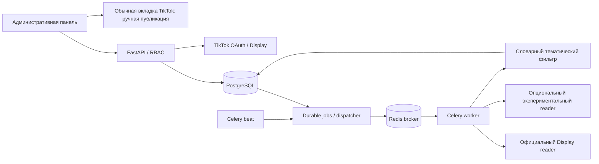
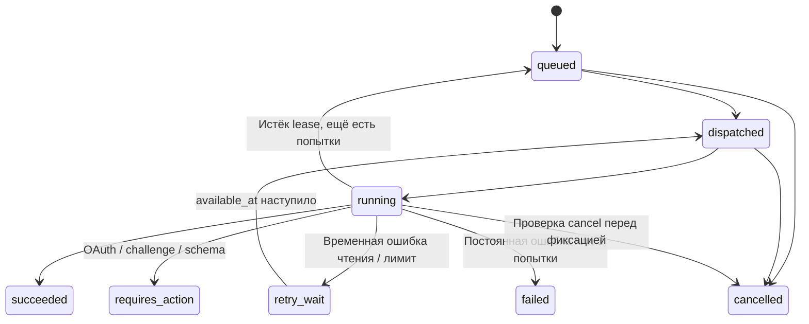

# Архитектура Lead Hunter API

## Граница MVP

Это отдельный пакет `tiktok_api`, отдельная БД `lead_hunter_api.db` локально и отдельный PostgreSQL в Compose. Существующее приложение `app/`, его данные, сессии и браузерная отправка не изменены. Старые cookies не превращаются автоматически в OAuth-токены. Старое приложение не является защищённым production API нового сервиса.

API рассчитан на одно рабочее пространство и около 10 принадлежащих владельцу аккаунтов. Это не multi-tenant SaaS. Роли привязаны к отдельным серверным ключам; персональные пользователи, SSO и изоляция организаций — отдельное расширение.

```text
tiktok_api/
  main.py                 HTTP endpoints, error mapping, panel, metrics
  config.py               validated environment and secrets
  db.py / models.py       sessions and domain tables
  schemas.py              strict input contracts
  security.py             roles, state hashes, encrypted vault
  accounts.py             OAuth identity and rotating tokens
  matching.py             explainable metadata filtering
  jobs.py                 durable queue, schedules, leases, deduplication
  worker.py               Celery tasks and beat schedule
  cli.py / run_local.py   database utilities and local supervision
  providers/
    official.py           documented OAuth / Display / Research HTTP calls
    experimental.py       explicitly enabled TikTokApi public reader
  static/                 administrative HTML/CSS/JS
migrations/               frozen Alembic schema
tests_api/                isolated automated tests
tools/                    reproducible evidence, smoke and Docker QA tools
deploy/                   development HTTPS configuration
docs/evidence/            source hashes, machine results, screenshots, OpenAPI
compose.yaml              PostgreSQL / Redis / API / workers / migrations
compose.experimental.yaml optional browser worker
compose.test.yaml         disposable QA project override
```



## Компоненты

| Компонент | Задача и взаимодействие | Основа / причина выбора | Ограничения |
|---|---|---|---|
| FastAPI + Pydantic | Контракты, проверка ввода, OpenAPI, роли | Небольшой типизированный HTTP backend | Sync handlers используют thread pool; увеличение реплик требует PostgreSQL/Redis |
| SQLAlchemy + PostgreSQL | Аккаунты, кампании, видеозаписи, черновики, задачи, аудит | Транзакции, row locks, уникальные ограничения | SQLite только для локального одного worker, не для production concurrency |
| Redis + Celery | Доставка фоновых чтений, ограничения частоты | Брокер отделён от HTTP; состояния задач остаются в БД | Один beat; состояние Celery AsyncResult не используется как источник истины |
| `providers/official.py` | Реальные OAuth/Display/Research HTTPS вызовы | Контракты TikTok, HTTPX; узкий клиент проще генерируемого SDK | Нет разрешённого метода произвольных комментариев; разные продукты требуют разных доступов |
| `providers/experimental.py` | Опциональный публичный поиск | TikTokApi 7.3.3, существующий video-search example | Неофициальный веб-метод, live-стабильность не обещана, остановка при challenge/schema error |
| `accounts.py` + Vault | OAuth state, token rotation, блокировка refresh/revoke | SHA-256 состояния + browser binding, Fernet/MultiFernet | Ключ шифрования хранится отдельно от БД; нужен backup ключа; KMS не интегрирован |
| `matching.py` | Тематический score и причины | Unicode NFKC, целые слова/фразы, исключения | Не морфологический/семантический classifier; `кофе` не совпадает с `кофейня` |
| `jobs.py` | Расписание, outbox, leases, дедупликация, retry | Собственная короткая orchestration layer | Только read/discovery jobs автоматически повторяются; никаких повторов публикации |
| Статическая панель | OAuth, сценарии, импорт, задачи, ручная очередь | Достаточна для 10 аккаунтов; без Node-сборки/CDN | Не React; backend API допускает замену панели без изменения доменной логики |
| Health, metrics, audit | Диагностика очереди и действий | `/health/*`, Prometheus text, журнал в БД | Алертинг и централизованный сбор журналов подключаются инфраструктурой |

Next.js не даёт существенной выгоды для небольшой внутренней CRUD-панели: в MVP выбран интерфейс без сборки. Переход на React не требует замены API. Для новых источников достаточно добавить reader, который возвращает нормализованные видео, и включить его в capability registry/контракты. Для writers необходим отдельный протокол результата, а не метод, который всегда возвращает success.

## Модель данных

Все таблицы имеют префикс `lh_`; даты в БД — UTC, во внешнем JSON — с суффиксом `Z`.

| Таблица | Содержимое | Инварианты |
|---|---|---|
| accounts | app-scoped open_id, scopes, encrypted tokens, сроки и status | open_id уникален; статусы active/reauthorization_required/revocation_pending/disconnected |
| oauth_states | Хеш state, хеш browser binding, expiry, used | Callback допускает однократный atomic compare-and-set |
| mutexes | Строка accounts | Сериализация проверки максимального числа подключений |
| campaigns | Аккаунт, источник, темы/исключения, текст, порог, расписание | Одна активная задача на кампанию; редактирование при активной задаче отклоняется |
| videos | external_id, ссылка, автор, описание, происхождение, доказанное владение | external_id уникален; импорт не может перезаписать официальные metadata |
| candidates | Результат фильтра по кампании | unique(campaign_id, video_id), score/terms/reason |
| drafts | Аккаунт, видео, текст, manual status | unique(account_id, video_id) защищает от повторов между кампаниями |
| jobs | Идемпотентность, статус, попытки, доступное время, lease, результат | idempotency_hash уникален; payload брокера содержит только job ID |
| audit | Роль, действие, ресурс, нормализованные детали | Нет токенов, cookies, authorization codes и полного upstream body |

Черновики существуют в статусах `pending`, `manual_confirmed`, `skipped`. `manual_confirmed` означает свидетельство оператора, не подтверждение TikTok. `publication_evidence=operator_self_report` и `verified_by_tiktok=false` не позволяют клиенту перепутать эти состояния.



## Расписания и доставка

HTTP-триггер сохраняет Job в транзакции и возвращает 202. Заголовок `Idempotency-Key` связывается с campaign ID; повтор возвращает ту же запись. Новый ключ при уже активной задаче возвращает активную задачу.

Каждые 15 секунд beat запускает dispatcher. Он восстанавливает истёкшие leases, выбирает due campaigns, транзакционно создаёт Jobs и передаёт ID в Celery. Сбой брокера возвращает запись в queued. Если worker умер, lease позволяет повторить чтение. Старый worker не может зафиксировать результат более новой попытки: проверяются status и номер attempt. Уникальные ограничения на видео/черновики защищают результат повторной доставки.

Не более трёх выполненных попыток. Между повторами учитывается `Retry-After` без сокращения указанной сервером паузы и локальная экспоненциальная задержка. Нет sleep на часы внутри worker: задача сохраняет `available_at`. OAuth exchange/неоднозначный refresh по сети не повторяется автоматически. При проблемах согласия требуется повторное подключение; captcha не решается автоматически.

В экспериментальном поиске ограничены количество роликов, время одного вызова и общий бюджет. Browser search не использует cookies владельцев из старого приложения и не выполняет записи. При остановке worker уже начавшийся HTTP read может завершиться; фиксация его результата проверяет отмену. Это не обещание мгновенного прерывания внешнего запроса.

## Endpoints

Полная проверяемая схема генерируется самим FastAPI: `/openapi.json`, интерактивный клиент — `/docs`. Данные требуют `Authorization: Bearer <key>`. Health, статические файлы, описание OpenAPI и OAuth callback публичны; callback дополнительно защищён state и HttpOnly browser binding.

| Метод / путь | Назначение | Роль |
|---|---|---|
| GET `/api/v1/capabilities` | Реальные возможности и ограничения | viewer+ |
| POST `/api/v1/oauth/start` | Authorization URL и binding-cookie | admin |
| GET `/api/v1/oauth/callback` | Однократный OAuth callback | state + browser cookie |
| GET `/api/v1/accounts` | Публичные поля аккаунтов | viewer+ |
| POST `/api/v1/accounts/{id}/refresh` | Проверить срок/обновить истекающий token | admin |
| DELETE `/api/v1/accounts/{id}` | Отзыв TikTok-доступа, остановка расписаний, очистка tokens | admin |
| GET/POST `/api/v1/campaigns` | Список / создание кампании | viewer+ / operator+ |
| PUT `/api/v1/campaigns/{id}` | Полное изменение конфигурации/расписания | operator+ |
| POST `/api/v1/campaigns/{id}/run` | Создать фоновую задачу; Idempotency-Key обязателен | operator+ |
| GET `/api/v1/campaigns/{id}/candidates` | Score и объяснение отбора | viewer+ |
| POST `/api/v1/videos/import` | Полные TikTok URL + metadata пользователя | operator+ |
| GET `/api/v1/videos` | Видео и происхождение данных | viewer+ |
| GET `/api/v1/jobs`, GET `/api/v1/jobs/{id}` | Статусы, попытки, нормализованные ошибки | viewer+ |
| POST `/api/v1/jobs/{id}/cancel` | Отмена | operator+ |
| GET `/api/v1/drafts` | Очередь с URL и evidence | viewer+ |
| PATCH `/api/v1/drafts/{id}` | Текст pending-черновика | operator+ |
| POST `/api/v1/drafts/{id}/publish` | Явный 409 unsupported, без сетевой отправки | operator+ |
| POST `/api/v1/drafts/{id}/manual-confirm` | Учёт ручного действия | operator+ |
| POST `/api/v1/drafts/{id}/skip` | Пропустить pending-черновик | operator+ |
| POST `/api/v1/research/videos/query` | Изолированное одобренное исследование | admin |
| GET `/api/v1/audit` | История действий | admin |
| GET `/metrics` | Метрики задач/аккаунтов | viewer+ |
| GET `/health/live`, GET `/health/ready` | Процесс / schema+DB+broker readiness | публично |

Коллекции поддерживают `limit` (до 200) и `offset`, где это применимо. Максимум импортируемых видео за запрос — 200, размер тела — 1 MiB. 150 символов комментария — консервативный лимит нашего MVP, не утверждение об универсальном лимите TikTok.

## Безопасность и эксплуатационные пределы

Секреты приходят из `.env`/environment; API не выдаёт access/refresh tokens. Fernet шифрует и аутентифицирует значения; MultiFernet поддерживает ротацию. Для production секреты следует подавать через менеджер секретов окружения. Доступ к БД и ключу вместе позволяет расшифровку: шифрование не заменяет разграничение доступа.

Bearer-ключи разных ролей должны отличаться и содержать минимум 32 случайных символа. Ключ панели хранится в памяти вкладки; после перехода OAuth/перезагрузки нужен повторный ввод. CORS не открыт. Валидация импортированных URL исключает произвольные хосты, userinfo, порты и shortlinks; backend не загружает введённые URL. На панели нет HTML-вставки пользовательского текста.

В Compose PostgreSQL и Redis не публикуют порты наружу. API привязан к loopback. Сервисы приложения работают от непривилегированного пользователя, с read-only filesystem и временным `/tmp`. Redis защищён отдельным паролем. Лимит API в Redis общий для реплик; локальный fallback только для режима разработки. Readiness не доказывает, что Celery worker/beat живы: следует мониторить рост queued/dispatched и heartbeat процессов отдельно.

Текущий аудит различает роли, а не конкретных сотрудников. Нет настроенного retention/удаления персональных данных, внешнего KMS, distributed tracing и готовых алертов. Перед многопользовательским или публичным размещением нужны персональные identities, инфраструктурные лимиты соединений и политика хранения. Эти функции не заявляются готовыми.
